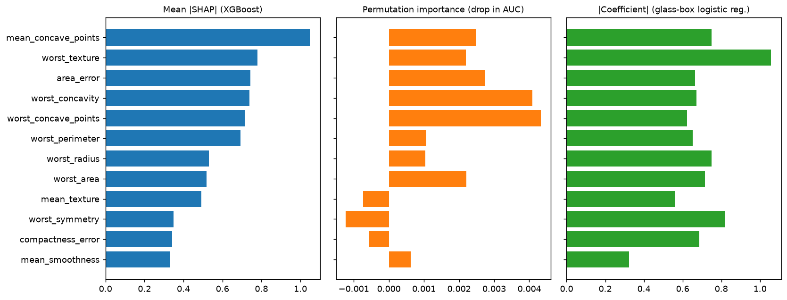
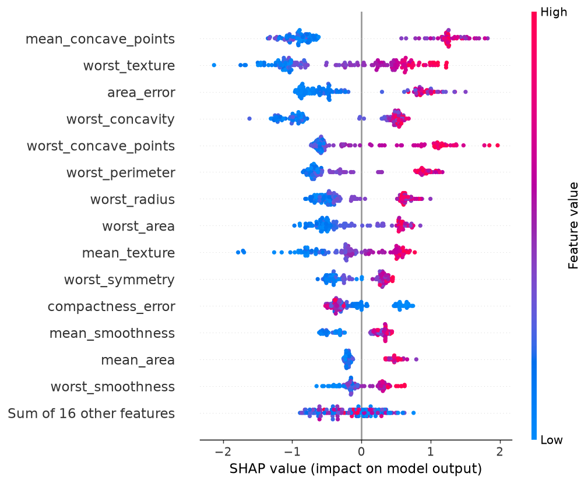
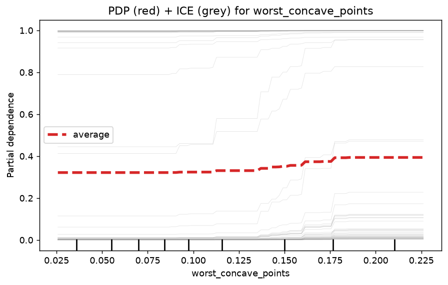
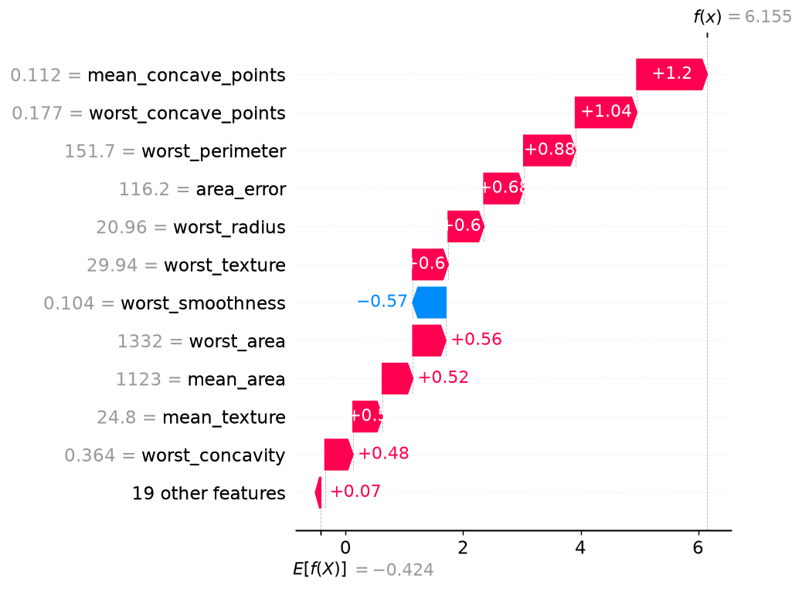
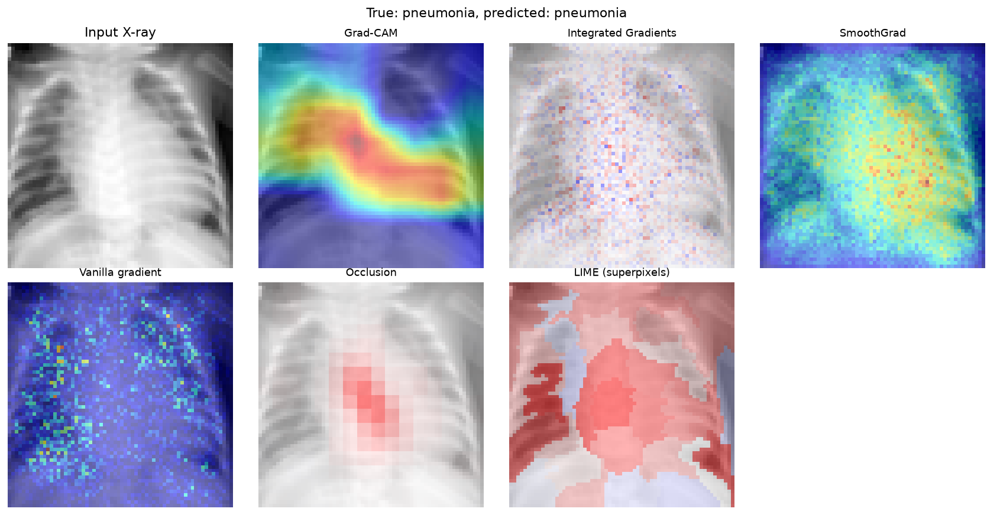
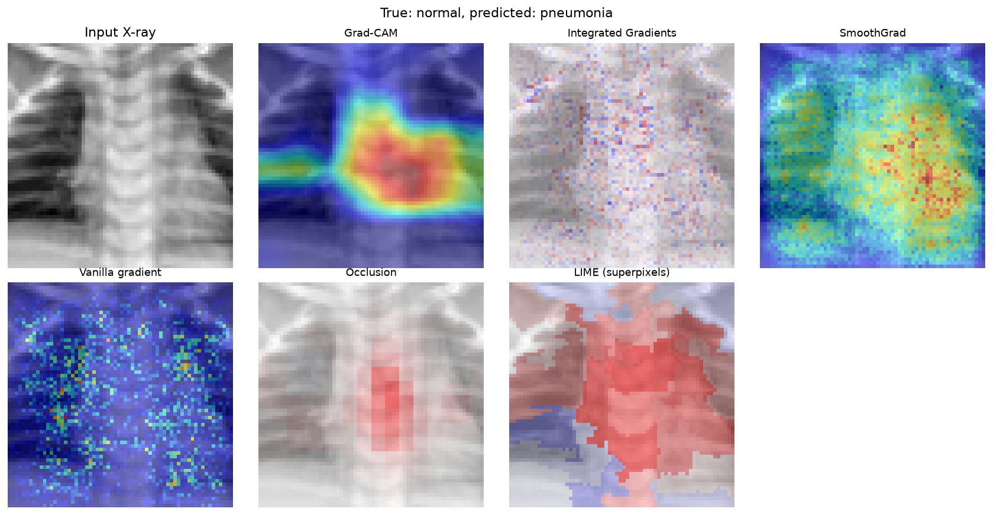
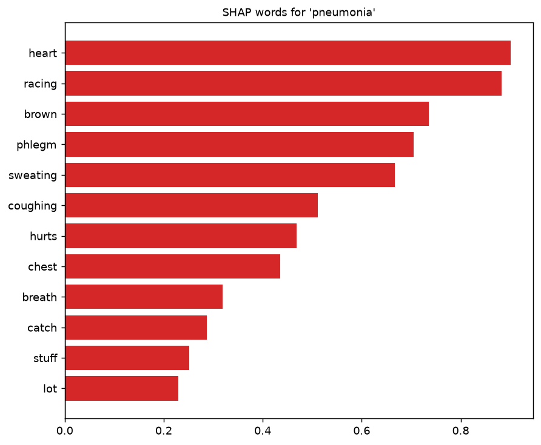
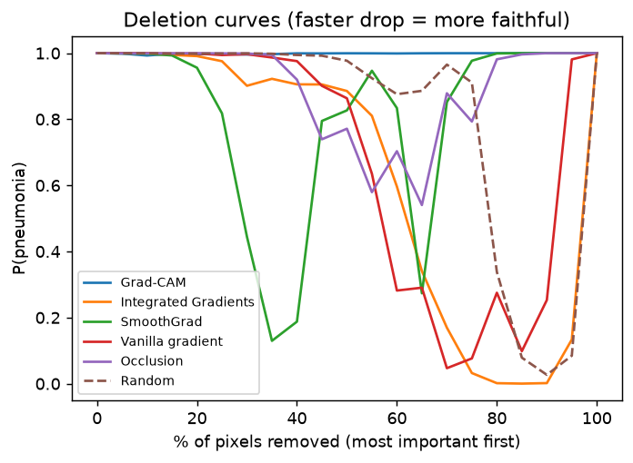
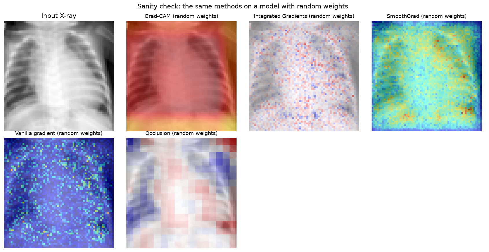

# MediXplain: A Multimodal Explainable-AI Workbench for Clinical Decision Support

**Course:** Explainable AI (23DC2022) · B.Tech AIDS, Semester VII · IA3 Project / Case Study
**Instructor:** Ms. Divina T P
**Student:** _your name, register number_

---

## Abstract

Clinicians will not act on an AI prediction they cannot question. MediXplain is a GUI application (Streamlit) that explains three clinical models, one for each data type:

| Case | Data | Model | Test performance |
|---|---|---|---|
| Breast-tumour malignancy | **Tabular**: 569 biopsies × 30 features | XGBoost (+ glass-box logistic regression) | AUC 0.996, accuracy 97.9% |
| Pneumonia on chest X-ray | **Image**: 5,856 paediatric X-rays, 64×64 | 4-block CNN (PyTorch) | AUC 0.980, accuracy 93.1% |
| Diagnosis from symptom text | **Text**: 1,065 descriptions, 22 diagnoses | TF-IDF + logistic regression | Accuracy 95.8%, macro-F1 0.956 |

The app applies **15 explanation techniques** in total. The main contribution is the **Trust Lab**, which tests the explanations themselves for faithfulness, model sensitivity, cross-method agreement and stability. These tests found real problems: some popular saliency maps partly ignore the model, and LIME changes with its random seed. They also gave a concrete argument that an interpretable model would serve the tabular task just as well.

---

## 1. Problem statement and objectives

A hospital is trialling three AI assistants: biopsy triage, X-ray screening and symptom-based triage. Before deployment, the ethics board asks for three things:

1. **Local explanations**: why did the model make *this* prediction for *this* patient?
2. **Global explanations**: what has the model learned overall?
3. **Evidence that the explanations can be trusted.** A heatmap that looks convincing but does not reflect the model is worse than no heatmap.

Objectives: (a) build accurate models on tabular, image and text data; (b) explain each one with suitable model-agnostic and model-specific methods; (c) evaluate the explanations quantitatively; (d) present everything in an interactive GUI with plain-language summaries for non-experts.

## 2. Background: XAI concepts used

| | Local | Global |
|---|---|---|
| **Model-agnostic** | LIME (tabular / image / text), occlusion, counterfactuals | Permutation importance, PDP / ICE |
| **Model-specific** | TreeSHAP, Grad-CAM, Integrated Gradients, SmoothGrad, vanilla gradients | Mean \|SHAP\|, SHAP beeswarm / dependence |
| **Intrinsic (glass-box)** | Logistic-regression contributions *wⱼxⱼ* | Coefficients |

- **SHAP** (Lundberg & Lee, 2017) assigns each feature its Shapley value φⱼ. The values add up exactly to *f(x) − E[f(x)]* (local accuracy). They are also consistent and give zero to missing features. TreeSHAP computes them exactly in polynomial time for tree ensembles.
- **LIME** (Ribeiro et al., 2016) perturbs the input, weights the samples by how close they are, and fits a sparse linear surrogate *g*. It is model-agnostic but random, and only valid locally.
- **Permutation importance** is the drop in test AUC when a feature's values are shuffled.
- **PDP / ICE** (Friedman, 2001; Goldstein et al., 2015) show the average and per-instance response curves.
- **Counterfactual explanations** (Wachter et al., 2017) find the smallest change *x′ − x* that flips the decision.
- **Grad-CAM** (Selvaraju et al., 2017) computes ReLU(Σₖ αₖAᵏ), where αₖ is the mean gradient of the class score over feature map *k* of the last convolutional layer.
- **Integrated Gradients** (Sundararajan et al., 2017) integrates gradients along a straight path from a baseline. It satisfies *completeness* and *sensitivity*.
- **SmoothGrad** (Smilkov et al., 2017) averages gradients over noisy copies of the input.
- **Occlusion** (Zeiler & Fergus, 2014) measures the drop in probability when a patch or word is hidden.

## 3. System design

```
medixplain/
├── app.py            Streamlit GUI (6 pages)
├── train_all.py      trains all models, runs every Trust Lab test, saves figures + metrics.json
├── xai/
│   ├── tabular.py    XGBoost, glass-box LR, SHAP, LIME, PDP/ICE, permutation importance, counterfactual search
│   ├── image.py      CNN, Grad-CAM, IG, SmoothGrad, saliency, occlusion, LIME superpixels, deletion curves
│   ├── text.py       TF-IDF+LR, LIME text, SHAP linear, word occlusion, contrastive "why A not B"
│   ├── trust.py      faithfulness, sanity check, agreement, stability tests
│   └── narrative.py  plain-English explanation cards generated from the computed numbers
├── data/  models/  results/
```

**GUI pages:** Overview · Tumour (tabular) · Chest X-ray (image) · Symptoms (text) · Trust Lab · Concepts & methods.

The interactive features are:
- what-if sliders on the six most influential tumour features;
- a LIME seed control, so users can see LIME's randomness for themselves;
- uploading your own X-ray;
- a choice of which class to explain;
- a side-by-side sanity check with a randomly weighted model;
- free-text symptom input with colour-highlighted words;
- a contrastive "why *pneumonia* and not *GERD*?" view;
- a live stability test.

## 4. Data and models

**Tabular.** Wisconsin Diagnostic Breast Cancer data (scikit-learn), with a 75/25 stratified split. Malignant is the positive class. XGBoost uses 300 trees of depth 3 with learning rate 0.05. The glass-box reference is an L2 logistic regression on standardised features.

**Image.** PneumoniaMNIST from MedMNIST v2 (CC BY 4.0), at 64×64 grayscale, with the official 4,708 / 524 / 624 split. The CNN has four conv-BN-ReLU blocks, global average pooling and dropout. Training used AdamW with a one-cycle learning-rate schedule and a class-weighted loss for 15 epochs, with random shifts and brightness jitter as augmentation. The checkpoint with the best validation AUC was kept.

**Text.** gretelai/symptom_to_diagnosis (853 train / 212 test, 22 classes). TF-IDF on 1- and 2-grams (sublinear term frequency, English stop words removed), then multinomial logistic regression with C = 10.

| Model | Accuracy | F1 | ROC-AUC |
|---|---|---|---|
| XGBoost (tabular) | 0.979 | 0.971 | 0.996 |
| Logistic regression (tabular glass-box) | 0.979 | 0.971 | **0.997** |
| CNN (X-ray) | 0.931 | 0.947 | 0.980 |
| TF-IDF + LR (text) | 0.958 | 0.956 (macro) | – |

## 5. Explanations by modality

### 5.1 Tabular



**Global view.** All three views rank the *worst* (largest-nucleus) measurements highest: concave points, perimeter, area and radius. Permutation importance is more concentrated, because correlated features share credit.



The beeswarm shows the direction of each effect: high concave-point and area values push toward malignant. In the PDP/ICE plot for `worst_concave_points`, the average (PDP) rises only from 0.32 to 0.40. Individual borderline patients (ICE lines), however, jump sharply near 0.135 and 0.16–0.175. Averaging hides these strong individual effects, which is exactly why ICE is shown alongside PDP.



**Local view: test patient #0** (P(malignant) = 99.8%). In the SHAP waterfall, mean and worst concave points contribute +1.2 and +1.04 log-odds and worst perimeter contributes +0.88. LIME picks out the same features as readable rules (e.g. *area_error > 45.39*).



**Counterfactual.** The greedy minimal-change search flips this patient to *benign* (P = 40.9%) with six coordinated reductions: worst perimeter 151.7 → 100.2, worst area 1332 → 597, worst texture 29.9 → 23.9, worst concavity, worst concave points and mean smoothness. Over 40 test patients, the search flipped **100%** of predictions, changing on average **4.9 features** with a total move of **3.7 standard deviations**.

### 5.2 Image



On this pneumonia case, Grad-CAM and occlusion focus on the central lung fields. Gradient-based maps (vanilla, IG) are noisy and pixel-level. SmoothGrad spreads over the whole lung area. LIME's superpixels agree with occlusion on the central-left region.



### 5.3 Text

For *"I'm sweating a lot and can't catch my breath… phlegm… heart is racing… coughing up brown stuff"* the model predicts **pneumonia (96%)**. SHAP, LIME and occlusion all highlight *heart, racing, phlegm, sweating, brown*. LIME also gives the word *throat* a negative weight, because throat words usually point toward a cold or allergy. The contrastive view against GERD shows that *throat* is the only word favouring the alternative.



## 6. Trust Lab: evaluating the explanations

### 6.1 Faithfulness

| Tabular: drop in P(predicted class) after resetting the top-5 features to the mean (↑) | |
|---|---|
| SHAP | **0.246** |
| LIME | 0.234 |
| Glass-box coefficients | 0.098 |
| Random 5 features | 0.024 |

| Image: deletion-curve AUC, 30 test X-rays (↓) | |
|---|---|
| Occlusion | **0.657** |
| Grad-CAM | 0.747 |
| Integrated Gradients | 0.775 |
| SmoothGrad | 0.791 |
| Vanilla gradient | 0.804 |
| Random | 0.832 |

| Text: ERASER comprehensiveness, top-3 words deleted (↑) | |
|---|---|
| LIME | **0.454** |
| Occlusion | 0.437 |
| SHAP | 0.433 |
| Linear contribution | 0.426 |
| Random | 0.084 |

On every data type, every method beats the random baseline. Occlusion wins on images because it measures exactly what the deletion test measures. On text, every method removes about five times as much probability as random words do.

**Design note.** The first version of the deletion test filled removed pixels with flat grey. With that fill, *random* maps scored best, because scattered grey pixels act as adversarial noise for a CNN. Filling with a blurred copy of the image (σ = 8) fixed this. This shows that the *metric* also needs a sanity check.



**Shortcut finding.** Several deletion curves climb back to P(pneumonia) ≈ 1 once nearly all pixels are replaced by the blurred image. A completely blurred X-ray is classified as pneumonia. The CNN has partly learned "hazy and low-contrast means pneumonia", which is a plausible shortcut that a radiologist should know about.

### 6.2 Sanity check: model-parameter randomisation (Adebayo et al., 2018)

Spearman similarity between the map from the trained CNN and the map from the same CNN with random weights. **Lower is better.**

| Method | Similarity | Verdict |
|---|---|---|
| Occlusion | 0.005 | ✅ passes |
| Vanilla gradient | 0.101 | ✅ passes |
| Integrated Gradients | 0.163 | ✅ mostly passes |
| Grad-CAM | 0.345 | ⚠️ partly reflects image structure |
| SmoothGrad | 0.455 | ⚠️ looks similar even with random weights |



SmoothGrad gives the "prettiest" maps, but nearly half of its structure survives destroying the model. Visual appeal is not evidence of faithfulness.

### 6.3 Agreement between methods

| Tabular (40 patients) | Top-5 overlap | Spearman |
|---|---|---|
| SHAP vs LIME | 0.68 | 0.77 |
| SHAP vs glass-box | 0.45 | 0.50 |
| LIME vs glass-box | 0.43 | 0.46 |

Text, top-3 word overlap: SHAP vs linear contribution 0.97, LIME vs occlusion 0.85, SHAP vs LIME 0.83, occlusion vs linear 0.76. On the example X-ray, the image methods form two families: region-based maps (Grad-CAM, occlusion, LIME, SmoothGrad; ρ ≈ 0.4–0.6) and pixel-gradient maps (vanilla, IG; ρ ≈ 0.45 with each other, under 0.1 with Grad-CAM).

### 6.4 Stability

| Test | Spearman |
|---|---|
| TreeSHAP: different seed | 1.000 (exact algorithm) |
| TreeSHAP: 1% input noise | 1.000 |
| LIME tabular: different seed | 0.901 |
| LIME tabular: 1% input noise | 0.936 |
| LIME text: different seed | 0.971 |

LIME's ranking changes with its random seed alone. On some patients (e.g. #5) the seed-to-seed Spearman drops to 0.73. Users can check this themselves with the seed control in the GUI.

## 7. Discussion

1. **Is the black box worth it?** The glass-box logistic regression matches XGBoost (AUC 0.997 vs 0.996). Rudin (2019) argues that for high-stakes decisions an interpretable model should be preferred when it performs equally well. This project supports that for the tabular task. The black box still uses features differently (top-5 overlap with the glass box is only 0.45), so the two models agree on the answer but differ in their reasons.
2. **Prefer explainers that are exact or that pass sanity checks.** Use TreeSHAP for trees and occlusion or IG for CNNs. Treat SmoothGrad and Grad-CAM heatmaps as approximate localisation, not proof.
3. **Explanations reveal shortcuts.** The blur result and the importance of words like *heart* and *racing* for pneumonia show what the models rely on. A clinician can then judge whether that reliance is acceptable.
4. **Plain-language cards** turn SHAP, Grad-CAM and word scores into sentences filled from the computed numbers, so the text can be checked against the plots.

## 8. Limitations and ethics

- Attributions explain the **model**, not the disease. They show correlation, not causation.
- The X-rays are low resolution (64×64). The symptom texts are synthetic patient phrasing. No model is clinically validated.
- Counterfactuals on biopsy measurements explain the decision boundary. They are not actionable advice.
- The search is greedy, so its counterfactuals are not guaranteed to be minimal.

## 9. Conclusion

MediXplain explains models on tabular, image and text data with 15 techniques in one interactive GUI, and it tests whether those explanations deserve trust. The main lesson is that explanation methods must be evaluated like models: some widely used saliency maps partly ignore the model, LIME varies with its seed, and even the evaluation metric needed a sanity check before it could be used.

## 10. How to run

```bash
pip install -r requirements.txt
python train_all.py        # about 2 minutes on a GPU, longer on CPU; downloads PneumoniaMNIST on first run
streamlit run app.py
```

## References

Adebayo et al. (2018) *Sanity Checks for Saliency Maps*, NeurIPS · DeYoung et al. (2020) *ERASER*, ACL · Friedman (2001) *Greedy Function Approximation* · Goldstein et al. (2015) *Peeking Inside the Black Box (ICE)* · Lundberg & Lee (2017) *A Unified Approach to Interpreting Model Predictions*, NeurIPS · Petsiuk et al. (2018) *RISE*, BMVC · Ribeiro et al. (2016) *"Why Should I Trust You?"*, KDD · Rudin (2019) *Stop Explaining Black Box Models…*, Nature MI · Selvaraju et al. (2017) *Grad-CAM*, ICCV · Smilkov et al. (2017) *SmoothGrad* · Sundararajan et al. (2017) *Axiomatic Attribution (IG)*, ICML · Wachter et al. (2017) *Counterfactual Explanations without Opening the Black Box* · Yang et al. (2023) *MedMNIST v2*, Scientific Data · Zeiler & Fergus (2014) *Visualizing and Understanding CNNs*, ECCV.
